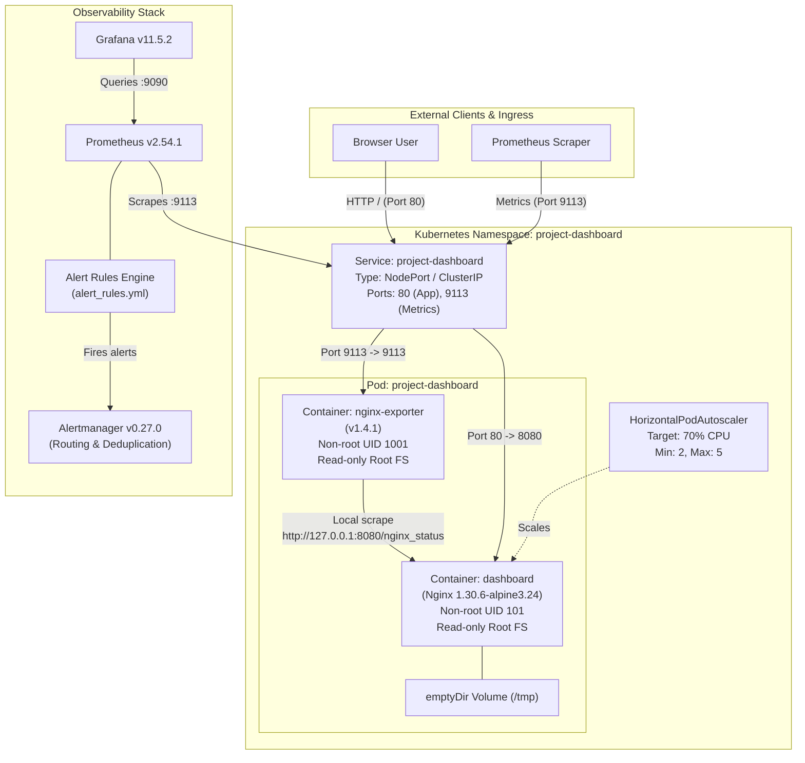
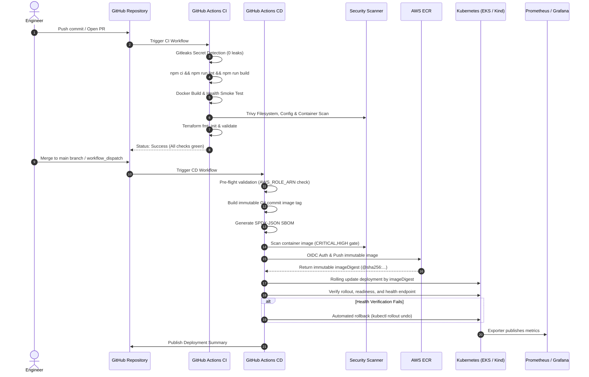
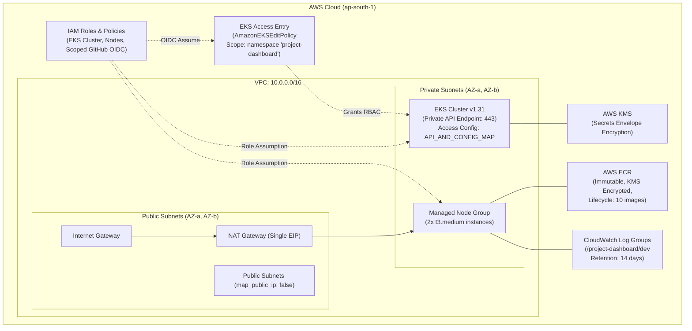

# DevOps Platform Architecture & System Design

## 1. Overview

The **Project Management DevOps Platform** is a production-grade, containerized Single Page Application (SPA) designed with defense-in-depth security, high availability, automated continuous integration & deployment (CI/CD), and end-to-end observability.

The architecture spans the entire software delivery lifecycle:
```
Developer Commit ──> GitHub Actions CI/CD ──> Security Gates ──> AWS ECR ──> Kubernetes (Kind / EKS) ──> Prometheus & Grafana
```

---

## 2. High-Level System Architecture



---

## 3. End-to-End Delivery Pipeline (CI/CD)



---

## 4. AWS Infrastructure Architecture (Terraform)

The infrastructure is provisioned through modular Terraform configurations adhering strictly to the principle of least privilege and CIS AWS Foundations benchmarks:



---

## 5. Defense-in-Depth Security Design

| Layer | Implementation | Security Objective | Detailed Guide |
| :--- | :--- | :--- | :--- |
| **Source Code** | Gitleaks, Dependabot weekly updates, `npm audit` 0 vulnerabilities | Prevent secret leakage and unpatched dependencies. | [SECURITY.md](SECURITY.md) |
| **Base Image** | `nginx:1.30.6-alpine3.24` with `apk update && apk upgrade --no-cache` | Zero known High/Critical OS CVEs. | [SECURITY.md](SECURITY.md) |
| **Container Runtime** | Non-root execution (`USER nginx`, UID 101), `readOnlyRootFilesystem: true`, dropped capabilities (`ALL`), `allowPrivilegeEscalation: false` | Prevent container breakout and runtime modifications. | [SECURITY.md](SECURITY.md) |
| **Network Security** | Nginx status endpoint limited to `127.0.0.1`, `::1`, and private CIDRs; HTTP security headers (`X-Frame-Options`, `X-Content-Type-Options`, `Referrer-Policy`) | Prevent information disclosure and clickjacking. | [SECURITY.md](SECURITY.md) |
| **Private EKS Network** | Private EKS control plane API with Ephemeral Actions Runner Controller (ARC) architecture | Eliminate public internet exposure of Kubernetes control plane. | [DEPLOYMENT_NETWORK_ARCHITECTURE.md](DEPLOYMENT_NETWORK_ARCHITECTURE.md) |
| **IAM & EKS Access** | Scoped OIDC subject claims, `AmazonEKSEditPolicy` scoped to namespace `project-dashboard` | Enforce strict least-privilege deployment authorization. | [IAM_AND_EKS_ACCESS.md](IAM_AND_EKS_ACCESS.md) |
| **State Security** | S3 remote state architecture with SSE-KMS, versioning, TLS policy, and native lockfile support | Protect infrastructure state from corruption and data leakage. | [TERRAFORM_STATE_MANAGEMENT.md](TERRAFORM_STATE_MANAGEMENT.md) |
| **Infrastructure** | KMS envelope encryption for secrets, private node subnets, ECR KMS encryption, tag immutability | Secure cloud infrastructure posture. | [INFRASTRUCTURE_SECURITY_REVIEW.md](INFRASTRUCTURE_SECURITY_REVIEW.md) |
