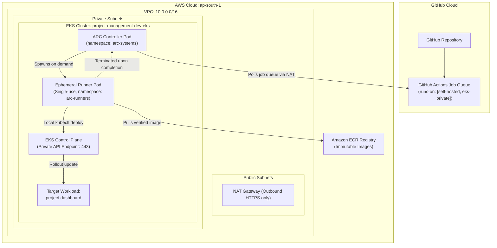
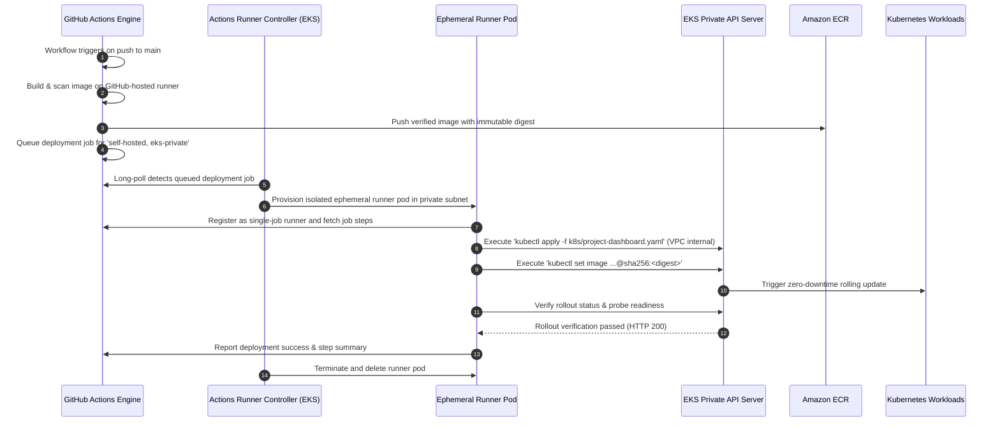

# Deployment Network Architecture: Private EKS Connectivity

## 1. The Architectural Challenge

The platform's infrastructure baseline enforces strict network defense:
- **Private EKS API Endpoint:** `endpoint_public_access = false` and `endpoint_private_access = true`.
- **Private Subnets:** EKS control plane and worker nodes reside strictly in private subnets (`10.0.11.0/24`, `10.0.12.0/24`) without public IP addresses.
- **Problem Statement:** Standard GitHub Actions runners execute in GitHub's multi-tenant public cloud. Without a route into the AWS VPC private subnets, a hosted runner cannot resolve or reach the private EKS control plane API endpoint (`https://<cluster-hash>.yl4.ap-south-1.eks.amazonaws.com`).

Opening the EKS API endpoint to `0.0.0.0/0` would defeat the zero-trust network boundary. This document details the architectural solutions evaluated and specifies the implementation of the recommended **Ephemeral Actions Runner Controller (ARC)** architecture.

---

## 2. Comparative Evaluation of Deployment Approaches

| Evaluation Criteria | Approach 1: Static EC2 Runner in VPC | Approach 2: Ephemeral ARC on EKS (Selected) | Approach 3: AWS Client VPN / SSM Tunnel |
| :--- | :--- | :--- | :--- |
| **Security & Isolation** | Moderate (persistent state between runs, credential leak risk) | **Highest** (single-use ephemeral pod, destroyed after each job) | High (TLS tunnel, but requires client tunnel key exchange) |
| **Network Exposure** | Private VPC only; outbound NAT | **Zero external exposure**; runs inside the cluster VPC | External client connects via VPN/SSM gateway |
| **Cost** | ~$15/month for continuous EC2 compute | **$0.00 incremental** (uses existing cluster capacity) | High (~$72/month for AWS Client VPN endpoint) |
| **Scalability** | Fixed instance size; manual scaling | **Dynamic autoscaling** (0 to N pods on demand) | Limited by VPN connection concurrency |
| **Maintenance** | High (OS patching, AMI rotation, runner updates) | **Low** (managed via Helm chart and Kubernetes controller) | High (tunnel daemon maintenance and PKI management) |
| **Operational Complexity** | Low to Medium | Low (declarative Kubernetes manifests) | High (dual network negotiation during CI step) |

---

## 3. Recommended Architecture: Ephemeral Actions Runner Controller (ARC)

The recommended pattern deploys GitHub's official **Actions Runner Controller (ARC)** inside the private EKS cluster.



---

## 4. End-to-End Private Deployment Network Flow



---

## 5. Declarative Implementation: ARC Deployment Manifest

To operationalize this architecture when provisioning EKS in AWS, the following declarative manifest is applied to the cluster:

```yaml
# k8s/arc-runner-deployment.yaml
apiVersion: actions.summerwind.dev/v1alpha1
kind: RunnerDeployment
metadata:
  name: devops-platform-runner
  namespace: arc-runners
spec:
  replicas: 1
  template:
    spec:
      repository: ArjunReddyVelma/project-mangement-app-main
      labels:
        - self-hosted
        - eks-private
        - linux
        - x64
      image: summerwind/actions-runner:latest
      serviceAccountName: cd-deployer-sa
      resources:
        limits:
          cpu: "1"
          memory: 1Gi
        requests:
          cpu: 250m
          memory: 512Mi
      securityContext:
        runAsNonRoot: true
        runAsUser: 1000
        readOnlyRootFilesystem: true
        allowPrivilegeEscalation: false
---
apiVersion: actions.summerwind.dev/v1alpha1
kind: HorizontalRunnerAutoscaler
metadata:
  name: devops-platform-runner-scaler
  namespace: arc-runners
spec:
  scaleTargetRef:
    name: devops-platform-runner
  minReplicas: 0
  maxReplicas: 3
  metrics:
    - type: TotalNumberOfQueuedAndInProgressWorkflowRuns
      repositoryNames:
        - ArjunReddyVelma/project-mangement-app-main
```

---

## 6. Security & Network Isolation Verification

1. **Zero Public Attack Surface:** The EKS API server resolves exclusively to private IP addresses within `10.0.11.0/24` and `10.0.12.0/24`.
2. **Ephemeral Identity:** Each runner pod receives a single-use registration token from GitHub. Upon job completion, the container is destroyed, leaving no persistent state, cached credentials, or artifacts.
3. **Internal DNS Routing:** All Kubernetes API communication is resolved through CoreDNS inside the VPC (`kubernetes.default.svc.cluster.local`), avoiding internet transit entirely.
