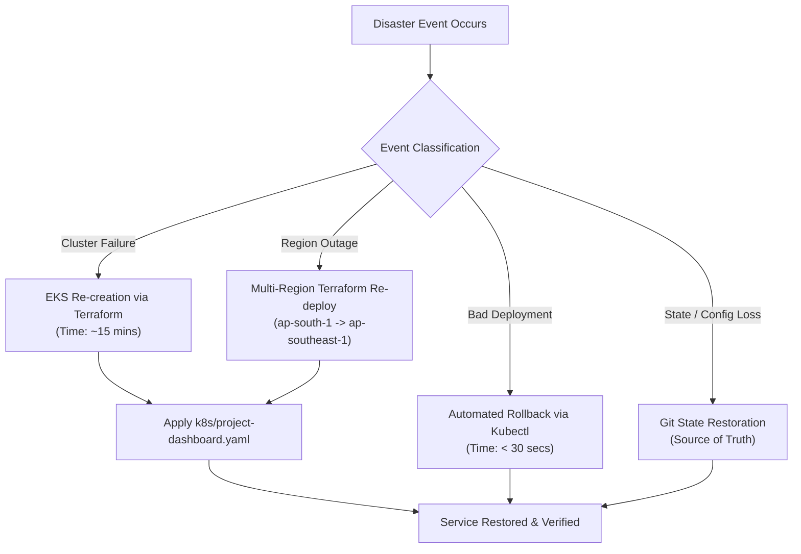

# Disaster Recovery & Business Continuity Plan

## 1. Objectives & Metrics

- **Recovery Point Objective (RPO):** < 15 minutes (Git-driven configuration, immutable container images in ECR).
- **Recovery Time Objective (RTO):** < 30 minutes (Automated Terraform recreation and Kubernetes deployment).
- **Data Classification:** Stateless Frontend SPA with client-side state; persistent observability metrics stored in Prometheus TSDB.

---

## 2. Disaster Scenarios & Mitigation Strategies



---

## 3. Disaster Scenarios & Recovery Procedures

### Scenario A: Total EKS Cluster Loss or Corruption
1. **Identify Root Cause:** Confirm that the cluster control plane or node groups are irreparably damaged.
2. **Re-provision EKS Infrastructure via Terraform:**
   ```bash
   cd terraform
   terraform init
   terraform apply -target=module.eks -auto-approve
   ```
3. **Configure Kubeconfig:**
   ```bash
   aws eks update-kubeconfig --region ap-south-1 --name project-management-dev-eks
   ```
4. **Deploy Workloads:**
   ```bash
   kubectl apply -f k8s/project-dashboard.yaml
   kubectl rollout status deployment/project-dashboard -n project-dashboard --timeout=120s
   ```
5. **Verify End-to-End Traffic:**
   ```bash
   curl -i http://<LoadBalancer-DNS>/health
   ```

---

### Scenario B: Full AWS Region Outage (`ap-south-1`)
1. **Switch Terraform Target Region:**
   In `terraform/terraform.tfvars`:
   ```hcl
   aws_region = "ap-southeast-1"
   ```
2. **Initialize & Apply in Failover Region:**
   ```bash
   terraform init
   terraform apply -auto-approve
   ```
3. **Re-point DNS via Amazon Route 53:**
   Update Route 53 alias record or Latency-Based Routing policy to direct user traffic to the secondary region endpoint.
4. **Confirm Metrics & Health:**
   Verify Prometheus and Grafana dashboards in the secondary region.

---

### Scenario C: ECR Repository Deletion or Corruption
1. **Re-create ECR Repository:**
   ```bash
   terraform apply -target=module.ecr -auto-approve
   ```
2. **Re-build & Re-push Image from Git SHA:**
   ```bash
   docker build -t <account_id>.dkr.ecr.ap-south-1.amazonaws.com/project-management-dashboard:<git-sha> .
   aws ecr get-login-password --region ap-south-1 | docker login --username AWS --password-stdin <account_id>.dkr.ecr.ap-south-1.amazonaws.com
   docker push <account_id>.dkr.ecr.ap-south-1.amazonaws.com/project-management-dashboard:<git-sha>
   ```

---

## 4. Disaster Recovery Testing Cadence

- **Quarterly Tabletop Simulation:** Walkthrough of multi-region failover and IAM OIDC recovery.
- **Bi-annual Destruction Test:** Tear down staging Kind / EKS cluster and rebuild from scratch to validate RTO under 30 minutes.
