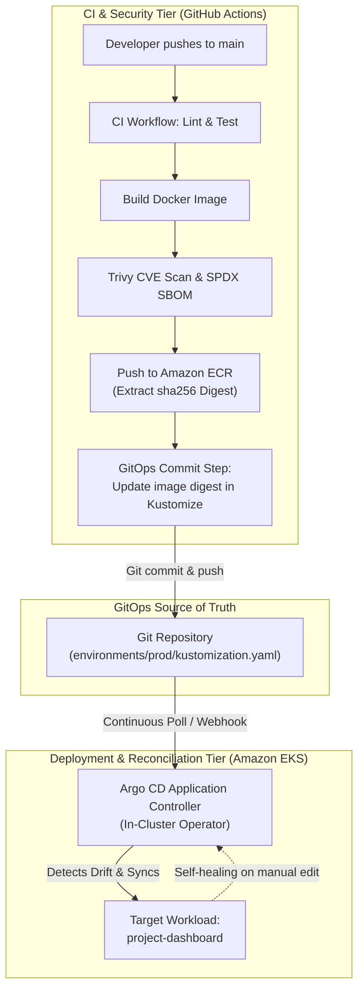

# GitOps & Release Management Strategy: Argo CD vs. Push-Based CD

## 1. Executive Summary

This strategy document evaluates release engineering models for the **Project Management Dashboard DevOps Platform**, comparing GitHub Actions push-based continuous deployment against a pull-based **GitOps (Argo CD)** architecture.

To satisfy the engineering mandate (*"Do not create a second deployment controller that conflicts with the existing CD pipeline. Ensure there is one clearly defined deployment authority"*), this document establishes the formal deployment authority boundary and specifies the production GitOps rollout blueprint.

---

## 2. Architectural Comparison: Push vs. Pull Models

| Evaluation Dimension | GitHub Actions Direct CD (Push Model) | Argo CD GitOps Controller (Pull Model) |
| :--- | :--- | :--- |
| **Control Origin** | External runner executes `kubectl set image` against the cluster API. | In-cluster operator continuously synchronizes cluster state with Git. |
| **Credential Boundary** | Runner requires AWS IAM / EKS Access Entry credentials. | Zero inbound cluster credentials; operator pulls declarations from Git. |
| **Drift Detection** | None (cluster changes made manually remain undetected until next deploy). | **Continuous & Automated** (detects drift every 3 minutes; self-heals). |
| **Single Source of Truth** | Git commit triggers build; live state is dynamic in cluster. | **Git is the absolute source of truth** for all environment configurations. |
| **Resource Overhead** | Minimal (ephemeral ARC pod exists only during deployment job). | Moderate (~1GB RAM / 0.5 vCPU for controller, repo-server, Redis, API). |
| **Failure Feedback** | Immediate exit-code failure in GitHub Actions step summary. | Asynchronous sync status via Argo CD dashboard / webhook notifications. |
| **Complexity** | Low (single `.github/workflows/cd.yml` workflow). | Moderate to High (requires multi-repo or multi-branch Kustomize layout). |

---

## 3. The Recommended Architecture: Hybrid GitOps Pipeline

To achieve the benefits of continuous drift detection while preserving immediate CI security scanning, we adopt a decoupled **Single Deployment Authority** model:



### Clarification of Deployment Authority:
1. **GitHub Actions Authority:** Responsible strictly for **Artifact Generation & Validation** (linting, testing, Trivy scanning, SBOM generation, ECR publishing, and committing the updated digest to Git). GitHub Actions **never executes `kubectl apply` directly**.
2. **Argo CD Authority:** Sole authority for **Cluster State Mutation**. Argo CD monitors Git, detects that the image digest has changed, and performs a controlled rolling synchronization into EKS.

---

## 4. Declarative Repository Structure (Kustomize Overlays)

To separate application source code from deployment environment manifests, the repository uses standard Kustomize overlays:

```
project-mangement-app-main/
├── k8s/
│   ├── base/
│   │   ├── deployment.yaml                   # Core deployment specifications
│   │   ├── service.yaml                      # Service definitions
│   │   ├── hpa.yaml                          # Horizontal Pod Autoscaler
│   │   └── kustomization.yaml                # Base resource aggregate
│   └── environments/
│       ├── dev/
│       │   ├── kustomization.yaml            # Dev-specific replicas (1) & local image
│       │   └── patch-resources.yaml          # Lower resource limits (50m CPU)
│       ├── staging/
│       │   ├── kustomization.yaml            # Staging digest & test ingress
│       │   └── patch-replicas.yaml           # Replicas (2)
│       └── production/
│           ├── kustomization.yaml            # Immutable ECR digest & ALB Ingress
│           └── patch-hpa.yaml                # Max replicas (5) & strict probes
```

### Production Kustomization Manifest
```yaml
# k8s/environments/production/kustomization.yaml
apiVersion: kustomize.config.k8s.io/v1beta1
kind: Kustomization

resources:
  - ../../base
  - ../../ingress.yaml

namespace: project-dashboard

images:
  - name: project-dashboard
    newName: <account_id>.dkr.ecr.ap-south-1.amazonaws.com/project-management-dashboard
    digest: sha256:d8a25c786016e1e83ec4285e7834a36f6d5329cf555b77bfb3080e72c88d8f3b

patches:
  - target:
      kind: Deployment
      name: project-dashboard
    patch: |-
      - op: replace
        path: /spec/replicas
        value: 2
```

---

## 5. Argo CD Declarative Application Manifest

```yaml
# k8s/argocd-application.yaml
apiVersion: argoproj.io/v1alpha1
kind: Application
metadata:
  name: project-dashboard-production
  namespace: argocd
  finalizers:
    - resources-finalizer.argocd.argoproj.io
spec:
  project: default
  source:
    repoURL: https://github.com/ArjunReddyVelma/project-mangement-app-main.git
    targetRevision: main
    path: k8s/environments/production
  destination:
    server: https://kubernetes.default.svc
    namespace: project-dashboard
  syncPolicy:
    automated:
      prune: true
      selfHeal: true
      allowEmpty: false
    syncOptions:
      - CreateNamespace=true
      - ApplyOutOfSyncOnly=true
    retry:
      limit: 5
      backoff:
        duration: 5s
        factor: 2
        maxDuration: 3m
```

---

## 6. Drift Detection, Reconciliation & Rollback Procedures

### Automated Drift Detection & Self-Healing
- **Sync Interval:** Argo CD performs deep cluster reconciliation every 180 seconds (or immediately upon GitHub webhook event).
- **Self-Healing Enforcement (`selfHeal: true`):** If an engineer manually alters deployment replicas, container images, or environment variables using `kubectl edit` in the cluster, Argo CD detects the divergence within 3 minutes and automatically overwrites the cluster state to match Git.

### GitOps Rollback Protocol
To execute a rollback in a GitOps architecture:
1. **Revert Git Commit:**
   ```bash
   # Revert the commit that bumped the image digest
   git revert <commit-sha>
   git push origin main
   ```
2. **Argo CD Reconciliation:**
   Argo CD detects the reverted digest in `k8s/environments/production/kustomization.yaml`, executes a rolling update back to the previous known good digest, and restores health automatically.
3. **Emergency Manual Rollback:**
   If Git is inaccessible during an active critical incident, operators execute `argocd app rollback project-dashboard-production <previous-revision-id>`, which temporarily suspends auto-sync until the incident is resolved.

---

## 7. Implementation Roadmap & Current Status

| Component | Target Architecture | Current Status | Notes |
| :--- | :--- | :--- | :--- |
| **Push-Based CD (`cd.yml`)** | Ephemeral ARC Runner in VPC | **IMPLEMENTED & HARDENED** | Primary deployment mechanism for current phase. |
| **GitOps Architecture Specification** | Argo CD Kustomize Overlays | **DOCUMENTED & ARCHITECTED** | Ready for operational rollout upon EKS provisioning. |
| **Argo CD Controller on AWS EKS** | In-Cluster Helm Operator | **BLOCKED — NOT TESTED** | Cluster not provisioned due to cloud non-provisioning rule. |