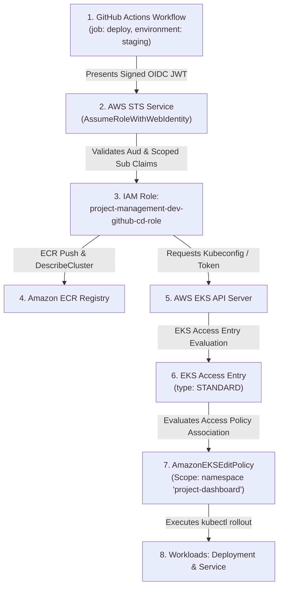

# IAM & EKS Access Control Architecture

## 1. End-to-End Authorization Flow

The platform eliminates static, long-lived AWS IAM access keys by leveraging cryptographic **OpenID Connect (OIDC)** identity federation and modern **EKS Access Entries**:



---

## 2. GitHub Actions OIDC Trust Policy

The IAM assume role trust policy enforces strict least-privilege scoping. Rather than using an insecure wildcard (`repo:owner/repo:*`), role assumption is permitted **only** when executed from the protected `main` branch or within designated GitHub Environments (`staging`, `production`):

```json
{
  "Version": "2012-10-17",
  "Statement": [
    {
      "Effect": "Allow",
      "Principal": {
        "Federated": "arn:aws:iam::<ACCOUNT_ID>:oidc-provider/token.actions.githubusercontent.com"
      },
      "Action": "sts:AssumeRoleWithWebIdentity",
      "Condition": {
        "StringEquals": {
          "token.actions.githubusercontent.com:aud": "sts.amazonaws.com"
        },
        "StringLike": {
          "token.actions.githubusercontent.com:sub": [
            "repo:ArjunReddyVelma/project-mangement-app-main:ref:refs/heads/main",
            "repo:ArjunReddyVelma/project-mangement-app-main:environment:staging",
            "repo:ArjunReddyVelma/project-mangement-app-main:environment:production"
          ]
        }
      }
    }
  ]
}
```

---

## 3. Least-Privilege IAM Deployment Policy

The deployment policy is strictly partitioned:
1. **ECR Authentication:** Global authorization token retrieval (`ecr:GetAuthorizationToken`).
2. **ECR Write Access:** Restricted exclusively to the application repository (`repository/project-management-dashboard`).
3. **EKS Describe Access:** Restricted exclusively to the target cluster (`cluster/project-management-dev-eks`) to generate the local kubeconfig.

```json
{
  "Version": "2012-10-17",
  "Statement": [
    {
      "Sid": "ECRAuth",
      "Effect": "Allow",
      "Action": ["ecr:GetAuthorizationToken"],
      "Resource": "*"
    },
    {
      "Sid": "ECRAccess",
      "Effect": "Allow",
      "Action": [
        "ecr:BatchCheckLayerAvailability",
        "ecr:GetDownloadUrlForLayer",
        "ecr:BatchGetImage",
        "ecr:PutImage",
        "ecr:InitiateLayerUpload",
        "ecr:UploadLayerPart",
        "ecr:CompleteLayerUpload",
        "ecr:DescribeRepositories",
        "ecr:ListImages",
        "ecr:DescribeImages"
      ],
      "Resource": "arn:aws:ecr:*:<ACCOUNT_ID>:repository/project-management-dashboard"
    },
    {
      "Sid": "EKSDescribe",
      "Effect": "Allow",
      "Action": ["eks:DescribeCluster"],
      "Resource": "arn:aws:eks:*:<ACCOUNT_ID>:cluster/project-management-dev-eks"
    }
  ]
}
```

---

## 4. Modern EKS Access Entries (Kubernetes Authorization)

In Kubernetes 1.31+, AWS EKS deprecates manual editing of the `aws-auth` ConfigMap in favor of declarative AWS APIs:

```hcl
resource "aws_eks_access_entry" "github_actions_cd" {
  cluster_name  = aws_eks_cluster.main.name
  principal_arn = var.github_actions_role_arn
  type          = "STANDARD"
}

resource "aws_eks_access_policy_association" "github_actions_cd" {
  cluster_name  = aws_eks_cluster.main.name
  policy_arn    = "arn:aws:eks::aws:cluster-access-policy/AmazonEKSEditPolicy"
  principal_arn = var.github_actions_role_arn

  access_scope {
    type       = "namespace"
    namespaces = ["project-dashboard"]
  }
}
```

### Why AmazonEKSEditPolicy is Preferred over AmazonEKSClusterAdminPolicy
- **Cluster Isolation:** Prevents the deployment pipeline from modifying nodes, namespace quotas, cluster roles, or system components in `kube-system`.
- **Blast Radius Reduction:** Limits rollout commands strictly to the `project-dashboard` namespace.

---

## 5. Worker Node IAM Permissions

Managed node groups execute under `aws_iam_role.eks_nodes`, which attaches standard AWS managed policies:
- `AmazonEKSWorkerNodePolicy`: Allows kubelet to join the EKS cluster.
- `AmazonEKS_CNI_Policy`: Configures IP addresses on pods via the AWS VPC CNI.
- `AmazonEC2ContainerRegistryReadOnly`: Permits worker nodes to pull container images securely from private Amazon ECR.

---

## 6. Verification & Troubleshooting Commands

```bash
# Verify OIDC role assumption
aws sts assume-role-with-web-identity \
  --role-arn arn:aws:iam::<ACCOUNT_ID>:role/project-management-dev-github-cd-role \
  --role-session-name test-session \
  --web-identity-token <JWT_TOKEN>

# Verify EKS Access Entry configuration
aws eks list-access-entries --cluster-name project-management-dev-eks --region ap-south-1

# Verify Kubernetes permissions for the IAM role
kubectl auth can-i create deployments -n project-dashboard --as <IAM_ROLE_ARN>
kubectl auth can-i create clusterroles --as <IAM_ROLE_ARN> # Expected: 'no'
```
