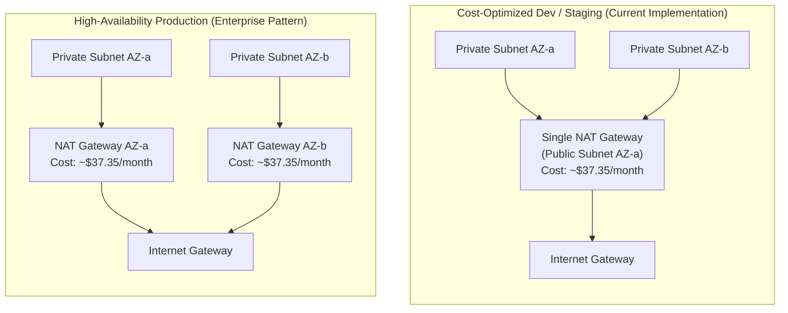

# Cloud Infrastructure Security & Hardening Review

## 1. Executive Summary

This security review audits the Terraform infrastructure modules (`vpc`, `iam`, `ecr`, `cloudwatch`, `eks`) for the **Project Management DevOps Platform** deployed in AWS `ap-south-1` (Mumbai). All modules have been evaluated against CIS AWS Foundations Benchmarks, AWS Well-Architected Framework (Security Pillar), and Aqua Trivy IaC static analysis.

---

## 2. Infrastructure Security Audit Matrix

| Domain | Resource / Setting | Configured State | Security Assessment & Mitigation |
| :--- | :--- | :--- | :--- |
| **VPC & Subnets** | Availability Zones | `ap-south-1a`, `ap-south-1b` | Distributed across 2 distinct availability zones for high availability. |
| **Subnet IPs** | `map_public_ip_on_launch` | `false` | Disabled on all subnets to prevent auto-assignment of public IPv4 addresses. |
| **EKS Endpoint** | `endpoint_public_access` | `false` | Kubernetes API completely shielded from public internet; zero public attack surface. |
| **EKS Endpoint** | `endpoint_private_access` | `true` | API traffic routes strictly over private VPC elastic network interfaces. |
| **KMS Encryption** | `aws_kms_key.eks` | Enabled, annual rotation | Customer-managed key used for envelope encryption of Kubernetes secrets at rest in etcd. |
| **ECR Encryption** | `encryption_type` | `KMS` | Container layers encrypted at rest using AWS KMS. |
| **ECR Immutability** | `image_tag_mutability` | `IMMUTABLE` | Prevents overwriting of published tags; enforces deterministic supply chain artifact promotion. |
| **ECR Lifecycle** | `aws_ecr_lifecycle_policy` | Expire > 10 images | Automatically prunes stale images, mitigating repository clutter and storage cost creep. |
| **CloudWatch** | `retention_in_days` | `14` days | Enforces log rotation; prevents indefinite log storage cost accumulation. |
| **Security Groups** | Cluster & Node Egress | `[var.vpc_cidr]` | Egress restricted strictly to VPC CIDR rather than unbounded `0.0.0.0/0`. |

---

## 3. NAT Gateway Architecture: Availability vs Cost Analysis

### The Operational Trade-Off
A NAT Gateway enables outbound internet egress for private subnets (e.g., pulling operating system security updates and communicating with third-party APIs).



### Comparative Analysis

| Dimension | Cost-Optimized Dev Architecture (Implemented) | High-Availability Production Architecture |
| :--- | :--- | :--- |
| **NAT Gateway Count** | **1 NAT Gateway** in `AZ-a` | **2 NAT Gateways** (1 in `AZ-a`, 1 in `AZ-b`) |
| **Hourly Cost** | $0.045 / hour | $0.090 / hour |
| **Monthly Baseline Cost** | **~$32.85 / month** | **~$65.70 / month** |
| **Data Processing Cost** | $0.045 / GB | $0.045 / GB + inter-AZ data charges ($0.01/GB saved) |
| **Cross-AZ Dependency** | Private subnet `AZ-b` routes cross-AZ traffic to `AZ-a` | Private subnets route egress strictly within their local AZ |
| **Failure Domain** | If AWS `AZ-a` suffers a facility outage, all outbound egress stops | If `AZ-a` fails, `AZ-b` maintains independent, uninterruptible egress |
| **Recommendation** | **Best for Development, CI/CD, and Portfolio testing** | **Mandatory for mission-critical production with strict SLAs** |

---

## 4. Dual Terraform Configuration Patterns

### Pattern A: Cost-Optimized Development (Active Baseline)
In `terraform/modules/vpc/main.tf`:
```hcl
resource "aws_eip" "nat" {
  domain = "vpc"
}

resource "aws_nat_gateway" "main" {
  allocation_id = aws_eip.nat.id
  subnet_id     = aws_subnet.public[0].id
}

resource "aws_route_table" "private" {
  vpc_id = aws_vpc.main.id
  route {
    cidr_block     = "0.0.0.0/0"
    nat_gateway_id = aws_nat_gateway.main.id
  }
}
```

### Pattern B: Multi-AZ High-Availability Production
To scale to multi-AZ production without code restructuring:
```hcl
resource "aws_eip" "nat" {
  count  = length(var.public_subnet_cidrs)
  domain = "vpc"
}

resource "aws_nat_gateway" "main" {
  count         = length(var.public_subnet_cidrs)
  allocation_id = aws_eip.nat[count.index].id
  subnet_id     = aws_subnet.public[count.index].id
}

resource "aws_route_table" "private" {
  count  = length(var.private_subnet_cidrs)
  vpc_id = aws_vpc.main.id
  route {
    cidr_block     = "0.0.0.0/0"
    nat_gateway_id = aws_nat_gateway.main[count.index].id
  }
}

resource "aws_route_table_association" "private" {
  count          = length(aws_subnet.private)
  subnet_id      = aws_subnet.private[count.index].id
  route_table_id = aws_route_table.private[count.index].id
}
```

---

## 5. Security Groups Audit & Principle of Least Privilege

1. **EKS Cluster Security Group (`aws_security_group.cluster`):**
   - Egress restricted to `[var.vpc_cidr]` to prevent unmonitored outbound internet communication directly from the managed control plane.
   - Ingress on port 443 permitted strictly from the worker node security group.
2. **Worker Node Security Group (`aws_security_group.nodes`):**
   - Node-to-node communication permitted on all ports (`0-65535`) within the security group for intra-pod CNI overlay networking.
   - Ingress on ports `1025-65535` permitted strictly from the cluster security group for kubelet metrics and exec commands.
   - Zero open inbound ports to public CIDRs (`0.0.0.0/0`).
