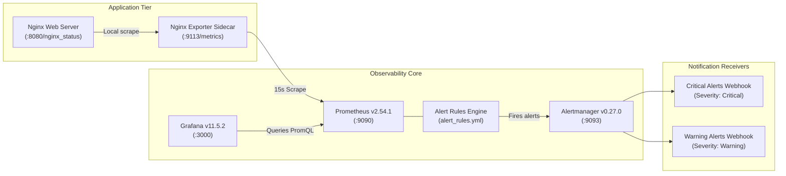

# Observability & Monitoring Guide

## 1. Monitoring Stack Architecture

The platform's observability stack integrates **Prometheus v2.54.1**, **Alertmanager v0.27.0**, **Grafana v11.5.2**, and the **Nginx Prometheus Exporter v1.4.1**:



---

## 2. Metrics Catalog & Instrumentation Reference

### Web Tier Metrics (Exported by `nginx-prometheus-exporter:1.4.1`)
| Metric Name | Prometheus Type | Description | Alerting Threshold |
| :--- | :--- | :--- | :--- |
| `nginx_up` | Gauge | Availability status of last scrape (`1` = UP, `0` = DOWN) | `nginx_up == 0` for 1m (Critical) |
| `nginx_connections_active` | Gauge | Total active client connections currently open | `> 100` for 2m (Warning) |
| `nginx_connections_reading` | Gauge | Client connections reading request headers | Tracked in Grafana |
| `nginx_connections_writing` | Gauge | Client connections writing responses to clients | Tracked in Grafana |
| `nginx_connections_waiting` | Gauge | Idle keep-alive connections waiting for new requests | Tracked in Grafana |
| `nginx_connections_accepted` | Counter | Cumulative accepted client TCP sockets | Monitored with `handled` for drops |
| `nginx_connections_handled` | Counter | Cumulative successfully handled connections | Drop alert if `accepted - handled > 0` |
| `nginx_http_requests_total` | Counter | Total HTTP requests served since process start | Rate spike `> 500 req/s` for 2m |

### Kubernetes Workload Metrics (Exported by Kubelet cAdvisor & kube-state-metrics)
| Metric Name | Prometheus Type | Description | Alerting Threshold |
| :--- | :--- | :--- | :--- |
| `container_cpu_usage_seconds_total` | Counter | CPU core seconds consumed by container | `rate(...) > 0.8` (80% utilization) for 3m |
| `kube_pod_container_status_restarts_total`| Counter | Cumulative container restarts in namespace | `increase(...) > 3` in 15m (Warning) |
| `kube_deployment_status_replicas_available`| Gauge | Available replicas in deployment | `< 2` for 2m (Critical) |

> [!NOTE]
> When running the local stack via Docker Compose, only web tier metrics are scraped. Kubernetes workload metrics are collected when running in Kind or AWS EKS with cAdvisor and kube-state-metrics enabled.

---

## 3. Alert Rules & Routing Architecture

Alert rules are defined in `monitoring/alert_rules.yml` and routed through Alertmanager (`monitoring/alertmanager.yml`):

### Web Tier Rules
1. **`NginxServiceDown` (Critical):** Fires when `nginx_up == 0` for 1 minute.
2. **`HighActiveConnections` (Warning):** Fires when active connections exceed 100 for 2 minutes.
3. **`HighRequestRateSpike` (Warning):** Fires when request throughput exceeds 500 requests/sec for 2 minutes.
4. **`DroppedConnectionsDetected` (Critical):** Fires when accepted TCP connections exceed handled connections over a 5-minute window (`increase(accepted) - increase(handled) > 0`).

### Kubernetes Workload Rules
5. **`HighContainerCpuUsage` (Warning):** Fires when container CPU utilization exceeds 80% for 3 minutes.
6. **`FrequentPodRestarts` (Warning):** Fires when container restarts exceed 3 in 15 minutes.
7. **`DeploymentReplicasUnavailable` (Critical):** Fires when available replicas drop below 2 for 2 minutes.

### Alertmanager Routing & Deduplication
- **Grouping:** Grouped by `alertname`, `severity`, and `job` with a 10s `group_wait` and 1m `group_interval` to prevent alert storms.
- **Inhibition:** Critical alerts automatically suppress duplicate warning alerts for the same instance (`inhibit_rules`).
- **Network Isolation:** Ports 9090, 9093, 3000, and 8080 are bound strictly to `127.0.0.1` (localhost only) in `docker-compose.yml` to prevent unintended public exposure.

---

## 4. Grafana Dashboards

The pre-provisioned dashboard **DevOps Platform Overview** (`uid: devops-platform-overview`) provides 9 visual panels:
1. **Nginx Service Availability:** Single-stat badge (`UP` in green / `DOWN` in red).
2. **Active Client Connections:** Current concurrent user sessions.
3. **Desired vs Ready Pod Replicas:** High-availability status counter.
4. **Pod Restarts (Past 15m):** Stability indicator.
5. **Nginx Request Rate:** Requests/sec throughput time series (`rate(nginx_http_requests_total[1m])`).
6. **Connection State Breakdown:** Stacked visualization of reading, writing, and waiting connections.
7. **Container CPU Utilization:** Real-time core allocation and consumption.
8. **Container Memory Usage:** Resident set size bytes.

### Accessing Grafana
```bash
# Start the full stack
docker compose up -d

# Dashboard URL: http://localhost:3000
# Default Credentials: admin / admin (configurable via GRAFANA_ADMIN_USER and GRAFANA_ADMIN_PASSWORD)
```

---

## 5. Verification Commands

```bash
# Verify Prometheus scrape targets
curl -s http://127.0.0.1:9090/api/v1/targets | jq '.data.activeTargets[] | {job: .labels.job, health: .health, lastScrape: .lastScrape}'

# Verify Alertmanager status
curl -s http://127.0.0.1:9093/api/v2/status | jq '.cluster.status'

# Verify active alert states
curl -s http://127.0.0.1:9090/api/v1/alerts | jq '.data.alerts'
```
