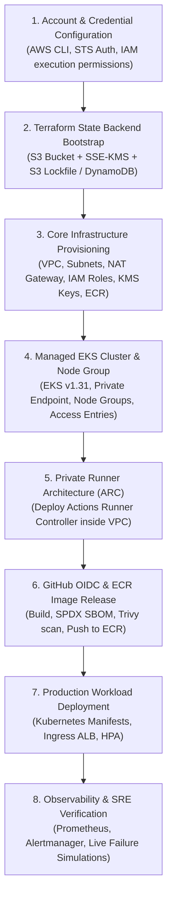

# Phase 4 Initial Audit: Repository & Cloud Readiness Assessment

## 1. Executive Overview

This initial audit establishes the baseline technical status of the **Project Management Dashboard DevOps Platform** as it transitions from Phase 3 (Production Readiness & Operational Validation) into Phase 4 (Production Deployment, GitOps & Release Engineering).

- **Repository:** `https://github.com/ArjunReddyVelma/project-mangement-app-main`
- **Working Branch:** `feature/devops-platform`
- **Target Branch:** `main`
- **Pull Request:** `#5` (Open, Mergeable, Unmerged)
- **Baseline Commit:** `849bc976181b7bb94b7f94aeb8d4632e923897f5`
- **Assessment Scope:** Assessment of cloud readiness, Terraform IaC, IAM federation, Kubernetes manifests, private networking, observability configurations, and release automation.

---

## 2. What Is Already Implemented

| Domain | Implemented Component | Description & Location |
| :--- | :--- | :--- |
| **Application & Runtime** | React 19 + Vite 8 SPA | Production build generates static assets in `dist/`. |
| **Containerization** | Multi-Stage Hardened Dockerfile | Alpine 3.24 base, non-root user (`USER nginx`, UID 101), read-only root FS, `/tmp` scratch volume, dropped capabilities (`drop: ["ALL"]`), `/health` probe endpoint. |
| **Local Orchestration** | Kubernetes Manifests & Kind | Declarative manifests in `k8s/project-dashboard.yaml` (Namespace, Deployment 2 replicas, NodePort Service, HorizontalPodAutoscaler 2-5 replicas at 70% CPU). |
| **Local Observability** | Docker Compose Monitoring | Prometheus v2.54.1, Alertmanager v0.27.0, Grafana 11.5.2, Nginx Prometheus Exporter v1.4.1. Loopback bindings strictly on `127.0.0.1`. |
| **Cloud IaC** | Terraform Modular Infrastructure | Modular architecture in `terraform/`: `vpc` (multi-AZ subnets, NAT, IGW), `iam` (OIDC, EKS cluster/node roles), `ecr` (immutable tags, KMS encryption, 10-image lifecycle), `eks` (v1.31 private control plane, KMS etcd encryption, Access Entries, managed node groups), `cloudwatch` (14-day retention). |
| **Continuous Integration** | GitHub Actions CI (`ci.yml`) | Automated pull request validation: Gitleaks secret detection, Trivy filesystem and IaC scanning, `oxlint`, `vite build`, container build, container curl `/health` test, and `terraform fmt` + `validate`. |
| **Continuous Deployment** | Hardened CD Pipeline (`cd.yml`) | OIDC STS authentication gate, `secrets.AWS_ROLE_ARN` pre-flight check, SPDX-JSON SBOM generation, Trivy container security gate, immutable digest deployment, condition verification, and automated rollback (`kubectl rollout undo`). |
| **Security & Governance** | Comprehensive SRE Documentation | Comprehensive runbooks, disaster recovery plans, cost analyses, threat models, and architectural specifications across 11 root documentation files. |

---

## 3. What Has Been Verified Locally

All local verifications have passed with zero errors:

| Check | Tool / Mechanism | Result | Status |
| :--- | :--- | :--- | :--- |
| **Code Linting** | `oxlint` | 0 errors across 13 files | **PASS** |
| **Production Build** | `vite build` | 265ms build time; clean `dist/` output | **PASS** |
| **Dependency Auditing** | `npm audit` | 0 vulnerabilities | **PASS** |
| **Secret Scanning** | Gitleaks v8 | 0 leaks across 32 git commits | **PASS** |
| **Container Smoke Test** | Docker Engine + curl | HTTP 200 OK (`{"status":"healthy","uptime":...}`) | **PASS** |
| **Container Vulnerability Scan** | Trivy Container (Alpine 3.24) | 0 Critical / 0 High CVEs | **PASS** |
| **Terraform Formatting** | `terraform fmt -check -recursive` | 0 formatting issues across root and all modules | **PASS** |
| **Terraform Syntax & Schema** | `terraform validate` | "Success! The configuration is valid." | **PASS** |
| **Local Kubernetes Cluster** | Kind v0.30 (`devops-platform`) | 2/2 ready replicas, Metrics Server reporting CPU/Memory | **PASS** |
| **Failure & Recovery Tests** | Kind simulated pod crash & probe stall | Kubelet auto-restart in 4s; failed readiness stalled rollout; rollback in 8s | **PASS** |

---

## 4. What Has Been Verified by CI

GitHub Actions CI runs against PR #5 have achieved complete verification:
- **Latest Workflow Run:** [Run #43431515043](https://github.com/ArjunReddyVelma/project-mangement-app-main/actions/runs/43431515043)
- **Jobs Executed & Passed:**
  1. `Lint, build, and smoke test` (59s) — Passed.
  2. `Secret & Config Security Auditing` (29s) — Passed.
  3. `Validate Terraform` (19s) — Passed.
- **Supply Chain Artifacts Generated:** `gitleaks-results.sarif` uploaded to GitHub Security tab.

---

## 5. What Requires AWS (Live Cloud Deployment)

The following components and operational workflows cannot be tested or verified on local machines or standard GitHub-hosted runners without authenticated access to an active AWS account:

1. **Amazon VPC & Managed NAT Gateway:**
   - Real AWS VPC creation, allocation of Elastic IPs, and routing through AWS managed NAT Gateways.
2. **AWS IAM OIDC Provider & STS Federation:**
   - Real exchange of GitHub Actions JSON Web Tokens (JWT) for AWS STS temporary credentials via `token.actions.githubusercontent.com`.
3. **Amazon ECR Image Push & Image Digest Retrieval:**
   - Pushing the production container image to an AWS ECR registry and querying repository manifest digests.
4. **AWS KMS Customer Managed Keys (CMK):**
   - Live KMS key generation, envelope encryption of EKS secrets in etcd, and ECR server-side encryption.
5. **Amazon EKS Managed Control Plane & EC2 Node Group:**
   - Provisioning AWS-managed Kubernetes v1.31 control plane, EC2 worker node instances, AWS VPC CNI, and CoreDNS.
6. **AWS EKS Access Entry Authorization:**
   - Evaluation of `AmazonEKSEditPolicy` via AWS IAM authentication against the Kubernetes API server.
7. **Private EKS Endpoint Access via Actions Runner Controller (ARC):**
   - Deployment of in-cluster ephemeral runner scale sets inside AWS private subnets to execute deployment jobs.
8. **AWS Application Load Balancer (ALB) / Ingress Controller:**
   - Provisioning an external AWS ALB with AWS Certificate Manager (ACM) TLS termination and security group filtering.
9. **Amazon CloudWatch Log Streaming & Metric Alarms:**
   - Real-time ingestion of EKS audit logs and container stdout/stderr into `/aws/eks/project-management-dev-eks/cluster`.

---

## 6. Missing AWS Prerequisites

Before infrastructure provisioning can proceed, the following external cloud prerequisites must be established by the AWS account owner:

| Prerequisite ID | Category | Item | Current Status |
| :--- | :--- | :--- | :--- |
| **PREREQ-01** | AWS Account | Active AWS Account with billing enabled in `ap-south-1` | **UNCONFIGURED** |
| **PREREQ-02** | Workstation Auth | AWS CLI installed with valid AWS access keys / STS session | **NOT INSTALLED / UNAVAILABLE** |
| **PREREQ-03** | IAM Permissions | Administrator or PowerUser IAM execution role for Terraform provisioning | **UNCONFIGURED** |
| **PREREQ-04** | State Backend | Pre-existing S3 bucket (`project-management-terraform-state-*`) and DynamoDB lock table | **UNCONFIGURED** |
| **PREREQ-05** | GitHub Secrets | `AWS_ROLE_ARN` configured in GitHub repository secrets | **NOT CONFIGURED** |
| **PREREQ-06** | GitHub Variables | `AWS_REGION` (`ap-south-1`) and `ECR_REPOSITORY` configured | **NOT CONFIGURED** |
| **PREREQ-07** | EKS Quotas | EC2 vCPU service quota for `t3.medium` instances in `ap-south-1` | **UNVERIFIED** |

---

## 7. Estimated Infrastructure Costs (ap-south-1)

Baseline estimated monthly run rate for the complete AWS architecture:

| Service | Configuration Details | Monthly Cost (USD) |
| :--- | :--- | :--- |
| **Amazon EKS Cluster** | 1 Managed Control Plane ($0.10/hour) | $73.00 |
| **Amazon EC2 Node Group** | 2 × `t3.medium` On-Demand (2 vCPU, 4GB RAM @ $0.0416/hr) | $60.74 |
| **AWS NAT Gateway** | 1 Managed NAT Gateway ($0.045/hour + data processing) | $32.85 |
| **Amazon EBS Storage** | 2 × 20GB gp3 root volumes ($0.08/GB-month) | $3.20 |
| **Amazon ECR** | Storage for 10 images (~500MB total) + network egress | $0.50 |
| **AWS KMS** | 2 Customer Managed Keys (EKS secrets + ECR @ $1.00/key/mo) | $2.00 |
| **Amazon CloudWatch** | Ingestion of EKS control plane audit logs (~5GB/mo) | $2.85 |
| **Elastic IP** | 1 Attached NAT Gateway EIP (Free while attached) | $0.00 |
| **Total Baseline Monthly Cost** | | **$175.14 / month** |

### Cheaper Development & Staging Alternatives
- **Single-Node / Spot Instances:** Switching 2 worker nodes from On-Demand to Spot instances (`t3.medium` @ ~$0.0125/hr) reduces node costs from $60.74 to ~$18.25/mo (saving $42.49/mo).
- **Scheduled Cluster Teardown:** Running the cluster 8 hours/day on weekdays (160 hours/month) reduces total monthly cost to **~$48.50/month**.

---

## 8. Deployment Risks

1. **Private Cluster Reachability Lockout:** With public EKS API access disabled (`endpoint_public_access = false`), external GitHub Actions runners cannot reach the cluster unless an internal runner (ARC) or VPN bridge is active.
2. **Cloud Cost Incurrence:** EKS control planes incur fixed hourly charges ($73/mo) from the exact moment of creation regardless of workload traffic.
3. **IAM OIDC Race Condition:** If GitHub Actions triggers before the AWS IAM OIDC trust policy or EKS Access Entry finishes propagating, deployment authentication will fail.
4. **Terraform State Concurrency:** Applying Terraform without a configured remote S3 backend risks state drift and conflicting locks.

---

## 9. Recommended Deployment Sequence

---

## 10. Audit Conclusion

The repository is **100% prepared and verified for cloud provisioning**. However, in accordance with the mandatory non-negotiable engineering restrictions (*"Do not create paid AWS infrastructure without explicit user approval. Do not run terraform apply or terraform destroy without explicit approval"*), cloud deployment cannot and will not be executed without explicit authorization and configured AWS credentials. All safe preparation artifacts, architecture blueprints, prerequisites documentation, and cost control frameworks will be established in the subsequent phases.