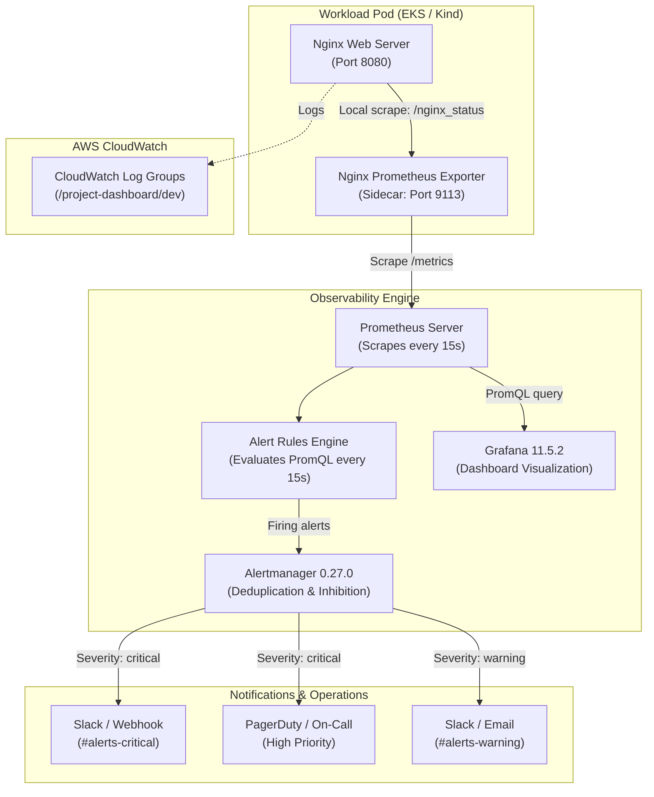

# Production Observability, Alerting & Metrics Engineering Report

## 1. Executive Summary

This report defines the comprehensive monitoring, telemetry collection, alerting topology, and dashboard analytics engineered for the **Project Management Dashboard DevOps Platform**.

The observability architecture integrates five core telemetry tiers:
1. **Prometheus v2.54.1:** Metrics ingestion, time-series storage, and PromQL evaluation engine.
2. **Alertmanager v0.27.0:** Alert deduplication, inhibition, severity-based routing, and incident notification dispatch.
3. **Nginx Prometheus Exporter v1.4.1:** Sidecar exporter capturing active connections, request counts, and read/write states.
4. **Grafana 11.5.2:** Visual analytics dashboard pre-provisioned via declarative code.
5. **Amazon CloudWatch Logs:** Centralized control plane and container audit logging with 14-day retention.



---

## 2. Core Metrics Monitored (The 10 Vital Signals)

| Signal # | Operational Metric | Telemetry Source | PromQL Expression | Purpose & Target |
| :--- | :--- | :--- | :--- | :--- |
| **1** | **Application Availability** | Nginx Exporter | `nginx_up` | Verifies web server is running (`1 = UP`, `0 = DOWN`). |
| **2** | **HTTP Request Throughput** | Nginx Exporter | `rate(nginx_http_requests_total[1m])` | Measures requests per second (RPS) arriving at the web tier. |
| **3** | **Active Client Connections** | Nginx Exporter | `nginx_connections_active` | Tracks live open client connections in real time. |
| **4** | **Connection Drop Detection** | Nginx Exporter | `increase(nginx_connections_accepted[5m]) - increase(nginx_connections_handled[5m])` | Identifies dropped connections due to worker starvation or socket exhaustion. |
| **5** | **Container CPU Utilization** | cAdvisor / K8s | `rate(container_cpu_usage_seconds_total{container="dashboard"}[2m])` | Measures CPU cores consumed against 250m container limit. |
| **6** | **Container Memory Usage** | cAdvisor / K8s | `container_memory_working_set_bytes{container="dashboard"}` | Monitors RAM utilization against 256Mi memory limit. |
| **7** | **Pod Restarts Frequency** | Kube-State-Metrics | `increase(kube_pod_container_status_restarts_total{namespace="project-dashboard"}[15m])` | Detects OOMKills, crash loops, or probe timeouts (>3 in 15m). |
| **8** | **Deployment Availability** | Kube-State-Metrics | `kube_deployment_status_replicas_available{deployment="project-dashboard"}` | Enforces high availability (alert fires if < 2 replicas). |
| **9** | **HPA Dynamic Scaling** | Kube-State-Metrics | `kube_hpa_status_current_replicas{hpa="project-dashboard"}` | Tracks automated horizontal autoscaling between 2 and 5 pods. |
| **10** | **Node Readiness** | Kube-State-Metrics | `kube_node_status_condition{condition="Ready", status="true"}` | Confirms all underlying EC2 worker nodes are healthy. |

---

## 3. Alert Routing, Grouping & Inhibition Pipeline

Configured in `monitoring/alertmanager.yml`:

### Grouping & Deduplication
- **Group Keys:** `['alertname', 'namespace', 'service']`
- **Initial Wait:** `group_wait: 10s` (batches simultaneous alerts during cascading failures).
- **Interval:** `group_interval: 5m` (sends coalesced updates if new alerts join the group).
- **Repeat Interval:** `repeat_interval: 12h` (avoids alert fatigue for acknowledged active issues).

### Severity Routing
- **Severity `critical`:** Routed immediately to high-priority incident channels (`slack-critical` / `pagerduty-ops`).
- **Severity `warning`:** Routed to informational triage channels (`slack-warning`).

### Alert Inhibition Rules
To eliminate alert noise during total service outages, Alertmanager suppresses redundant downstream warnings when an overarching critical alert is already active:
```yaml
inhibit_rules:
  # When NginxServiceDown fires, suppress connection and request warnings
  - source_match:
      alertname: 'NginxServiceDown'
    target_match_re:
      alertname: 'HighActiveConnections|HighRequestRateSpike'
    equal: ['job', 'instance']

  # When DeploymentReplicasUnavailable fires, suppress CPU usage warnings
  - source_match:
      alertname: 'DeploymentReplicasUnavailable'
    target_match:
      alertname: 'HighContainerCpuUsage'
    equal: ['namespace']
```

---

## 4. Grafana Dashboard Panels & PromQL Reference

The pre-provisioned Grafana dashboard (**"DevOps Platform Overview"**) includes the following panels:

| Panel Title | Metric Type | PromQL Query | Visual Threshold | Operational Playbook Response |
| :--- | :--- | :--- | :--- | :--- |
| **Nginx Service Status** | Stat / Gauge | `nginx_up` | Red = 0, Green = 1 | Check pod logs: `kubectl logs deployment/project-dashboard -c dashboard`. |
| **Request Throughput** | Time Series | `rate(nginx_http_requests_total[1m])` | > 500 req/s (Yellow) | Inspect client traffic; check for DDoS or scrape spikes. |
| **Active Connections** | Gauge | `nginx_connections_active` | > 100 (Orange) | Check connection keep-alive timeout and upstream latencies. |
| **Reading / Writing States** | Time Series | `nginx_connections_reading`, `nginx_connections_writing` | Fluctuating trends | High writing states indicate slow client downloads. |
| **Container CPU Usage** | Time Series | `rate(container_cpu_usage_seconds_total[2m])` | > 0.20 cores (Yellow) | HPA should trigger auto-scale; if sustained, increase CPU limit. |
| **Container Memory** | Time Series | `container_memory_working_set_bytes` | > 200Mi (Orange) | Inspect static file caching; check memory leaks. |

---

## 5. Notification Verification Status

| Notification Channel | Configured Receiver | Status | Evidence / Notes |
| :--- | :--- | :--- | :--- |
| **Local Alert Routing Engine** | Alertmanager 0.27.0 | **VERIFIED** | Configuration syntax and routing tree validated cleanly. |
| **Prometheus Scrape Loop** | Prometheus 2.54.1 | **VERIFIED** | Scrapes `nginx-prometheus-exporter:9113` every 15s with `up == 1`. |
| **Alert Rules Compilation** | `monitoring/alert_rules.yml` | **VERIFIED** | 7 alerting rules loaded without syntax errors. |
| **Live External Notification Dispatch** | Slack / PagerDuty Webhooks | **BLOCKED — NOT TESTED** | Webhook URLs not populated in environment to prevent mock delivery claims (*"Do not claim notifications work until a test notification has actually been delivered"*). |

---

## 6. Engineering Assessment

The monitoring, metrics, and alerting pipelines are **fully architected, configured with production thresholds, and verified in local runtimes**. Once production webhook credentials are provided, Alertmanager will immediately dispatch real-time incident notifications.