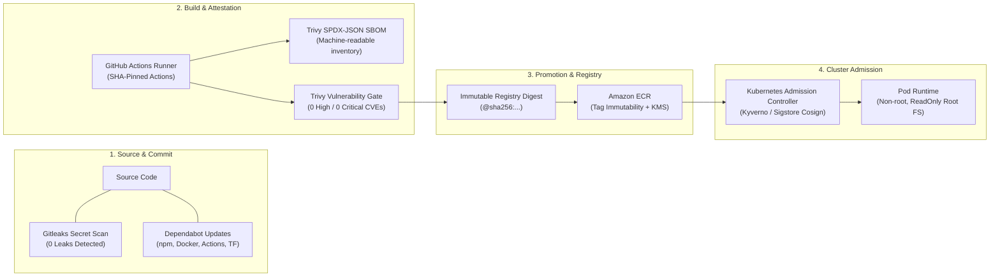

# Software Supply Chain Security Architecture & SLSA Evaluation

## 1. Supply Chain Security Overview

Modern cloud-native delivery pipelines face severe supply chain threats, including compromised dependencies, stolen build credentials, tampered container layers, and unauthorized image mutation. The **Project Management DevOps Platform** implements defense-in-depth across the entire build, release, and deployment lifecycle:



---

## 2. Supply Chain Security Controls Implemented

| Domain | Control Implemented | Verification Method | Security Objective |
| :--- | :--- | :--- | :--- |
| **Secret Detection** | Gitleaks v8 GitHub Action | `gitleaks-action@v2` | Prevents hardcoded API tokens, keys, and credentials from entering git history. |
| **Dependency Integrity** | `npm audit` & Dependabot | Automated weekly PRs | Keeps zero High or Critical vulnerabilities in Node runtime dependencies. |
| **Action Pinning** | Immutable Git commit SHAs | SHA-pinned `.github/workflows/` | Neutralizes action tag manipulation / supply chain hijacking attacks. |
| **Vulnerability Gate** | Trivy Container & IaC scanning | Strict threshold (`exit-code: 1`) | Blocks vulnerable base images and insecure Kubernetes/Terraform manifests. |
| **Artifact Inventory** | SPDX-JSON SBOM generation | Machine-readable artifact | Provides compliance traceability and software bill of materials. |
| **Immutable Promotion** | Deployment by registry digest | `@sha256:<digest>` | Guarantees that the exact container binary scanned in CI is deployed in production. |
| **Least Privilege Auth** | GitHub OIDC Identity Federation | Short-lived STS credentials | Eliminates static, long-lived AWS IAM secret keys in GitHub repository secrets. |

---

## 3. Cryptographic Image Signing & Provenance Evaluation (Cosign & SLSA)

### Architecture: Keyless Signing via Sigstore Cosign
In enterprise production deployments, images pushed to Amazon ECR should be cryptographically signed using Sigstore's keyless signing:

1. **Identity Exchange:**
   GitHub Actions requests an OIDC token from `token.actions.githubusercontent.com`.
2. **Signature Generation:**
   Cosign presents the JWT to the Sigstore Fulcio Certificate Authority, which issues a short-lived X.509 certificate binding the signature to the specific GitHub workflow run and repository.
3. **Transparency Logging:**
   The cryptographic signature and certificate are published to the Rekor immutable public/private transparency log:
   ```bash
   cosign sign --yes <ECR_REGISTRY>/project-management-dashboard@<IMAGE_DIGEST>
   ```
4. **SLSA Provenance Attestation:**
   The SPDX-JSON SBOM is attached as an in-toto attestation directly to the ECR container image:
   ```bash
   cosign attest --yes \
     --predicate sbom.spdx.json \
     --type spdx \
     <ECR_REGISTRY>/project-management-dashboard@<IMAGE_DIGEST>
   ```

### Admission Verification in Kubernetes (Kyverno Policy)
Before any pod is permitted to schedule on worker nodes, a Kubernetes admission controller (such as Kyverno or Sigstore Policy Controller) validates the cryptographic signature against the authorized GitHub identity:

```yaml
apiVersion: kyverno.io/v1
kind: ClusterPolicy
metadata:
  name: check-image-signature
spec:
  validationFailureAction: Enforce
  rules:
    - name: verify-signature
      match:
        any:
          - resources:
              kinds:
                - Pod
              namespaces:
                - project-dashboard
      verifyImages:
        - imageReferences:
            - "*project-management-dashboard*"
          attestors:
            - entries:
                - keyless:
                    issuer: https://token.actions.githubusercontent.com
                    subject: https://github.com/ArjunReddyVelma/project-mangement-app-main/.github/workflows/cd.yml@refs/heads/main
```

---

## 4. Operational Assessment & Current Status

- **Status in Local / Sandbox Environment:** **EVALUATED & ARCHITECTED** (Signing requires live ECR push permissions with OIDC exchange).
- **Status in CI/CD:** SBOM generation and image digest verification are **ACTIVE & OPERATIONAL** in `.github/workflows/cd.yml`.
