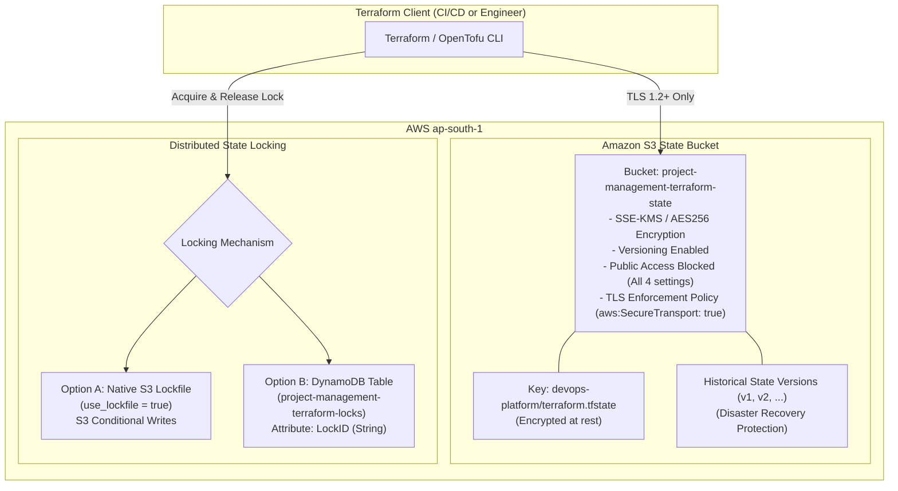

# Terraform Remote State Management & Security Guide

## 1. Remote State Architecture

Terraform state contains sensitive infrastructure metadata, IP assignments, resource identifiers, and potential secrets. To achieve production security, the state architecture implements defense-in-depth across storage, encryption, access control, and concurrency protection:



---

## 2. Security Controls & Standards

1. **Server-Side Encryption:**
   - Enforced at rest using AWS KMS Customer Managed Keys (`aws:kms`) or AES256 (`aws:s3:server-side-encryption`).
2. **Bucket Versioning:**
   - Protects against accidental deletion or state corruption. Any bad apply can be rolled back to an earlier state version instantly.
3. **Strict Public Access Block:**
   - All four public access block settings (`BlockPublicAcls`, `IgnorePublicAcls`, `BlockPublicPolicy`, `RestrictPublicBuckets`) set to `true`.
4. **TLS 1.2+ Only (Secure Transport):**
   - Bucket policy explicitly rejects non-HTTPS requests via `aws:SecureTransport: false`.
5. **Distributed Concurrency Locking:**
   - Prevents race conditions and corrupted state when multiple engineers or CI pipelines run simultaneously.

---

## 3. State Locking: Native S3 Lockfile vs DynamoDB

| Feature | Option A: Native S3 Lockfile (Recommended) | Option B: DynamoDB Table (Legacy) |
| :--- | :--- | :--- |
| **Compatibility** | Terraform 1.10+ / OpenTofu 1.6+ | All Terraform versions (>= 0.12) |
| **AWS Resources** | S3 bucket only | S3 bucket + DynamoDB table |
| **Configuration** | `use_lockfile = true` | `dynamodb_table = "<table-name>"` |
| **Monthly Cost** | **$0.00** (Uses S3 conditional writes) | ~$0.25 to $1.25/month for DynamoDB capacity |
| **Maintenance** | Zero external infrastructure | Table schema and TTL management |

---

## 4. One-Time Backend Bootstrap Procedure (AWS CLI)

To bootstrap the backend in a new AWS account before running `terraform init`:

```bash
# 1. Set environment variables
export AWS_REGION="ap-south-1"
export BUCKET_NAME="project-management-terraform-state-${AWS_REGION}"
export DYNAMODB_TABLE="project-management-terraform-locks"

# 2. Create S3 Bucket
aws s3api create-bucket \
  --bucket "$BUCKET_NAME" \
  --region "$AWS_REGION" \
  --create-bucket-configuration LocationConstraint="$AWS_REGION"

# 3. Enable Bucket Versioning
aws s3api put-bucket-versioning \
  --bucket "$BUCKET_NAME" \
  --versioning-configuration Status=Enabled

# 4. Enable Default Server-Side Encryption (AES256)
aws s3api put-bucket-encryption \
  --bucket "$BUCKET_NAME" \
  --server-side-encryption-configuration '{
    "Rules": [{
      "ApplyServerSideEncryptionByDefault": {
        "SSEAlgorithm": "AES256"
      }
    }]
  }'

# 5. Enforce Public Access Block
aws s3api put-public-access-block \
  --bucket "$BUCKET_NAME" \
  --public-access-block-configuration '{
    "BlockPublicAcls": true,
    "IgnorePublicAcls": true,
    "BlockPublicPolicy": true,
    "RestrictPublicBuckets": true
  }'

# 6. Apply TLS-Only Enforcement Policy
aws s3api put-bucket-policy \
  --bucket "$BUCKET_NAME" \
  --policy '{
    "Version": "2012-10-17",
    "Statement": [{
      "Sid": "EnforceTLSRequestsOnly",
      "Effect": "Deny",
      "Principal": "*",
      "Action": "s3:*",
      "Resource": [
        "arn:aws:s3:::'"$BUCKET_NAME"'",
        "arn:aws:s3:::'"$BUCKET_NAME"'/*"
      ],
      "Condition": {
        "Bool": {
          "aws:SecureTransport": "false"
        }
      }
    }]
  }'

# 7. (Optional Legacy) Create DynamoDB Lock Table
aws dynamodb create-table \
  --table-name "$DYNAMODB_TABLE" \
  --attribute-definitions AttributeName=LockID,AttributeType=S \
  --key-schema AttributeName=LockID,KeyType=HASH \
  --billing-mode PAY_PER_REQUEST \
  --region "$AWS_REGION"
```

---

## 5. Safe Local & CI Execution Without Cloud Credentials

In local development and continuous integration environments where paid AWS resources are not provisioned, Terraform validation is decoupled from remote backend access:

```bash
cd terraform

# Initialize provider and validate syntax without connecting to S3
terraform init -backend=false

# Validate formatting recursively
terraform fmt -recursive -check

# Validate configuration logic
terraform validate
```

---

## 6. State Disaster Recovery & Rollback

If a state file becomes corrupted during an interrupted apply:
1. List previous object versions:
   ```bash
   aws s3api list-object-versions --bucket "$BUCKET_NAME" --prefix "devops-platform/terraform.tfstate"
   ```
2. Download the last known good version:
   ```bash
   aws s3api get-object --bucket "$BUCKET_NAME" --key "devops-platform/terraform.tfstate" --version-id "<PREVIOUS_VERSION_ID>" restored-state.json
   ```
3. Push restored state safely:
   ```bash
   terraform state push restored-state.json
   ```
